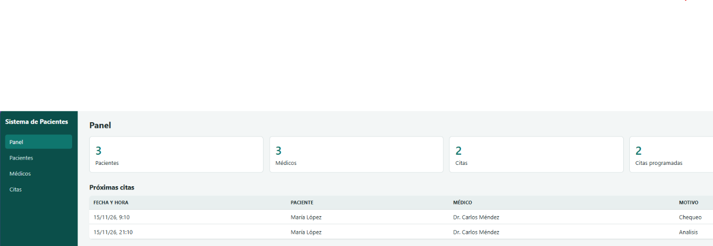

# Sistema de Pacientes

CRUD de un sistema de pacientes hecho con una API en .NET 10 organizada en capas y un frontend en React + TypeScript que la consume.

## Tecnologías

- **Backend:** ASP.NET Core Web API (.NET 10), Entity Framework Core 10 (Code First), SQL Server LocalDB, Swagger
- **Frontend:** React + TypeScript, Vite, React Router
- **Base de datos:** `PacientesDb` (10 tablas)

## Arquitectura en capas

```
backend/
  SistemaPacientes.Domain          Entidades e interfaces de repositorios
  SistemaPacientes.Application     Servicios, DTOs, interfaces de servicios y ServiceResult
  SistemaPacientes.Infrastructure  DbContext, migraciones e implementación de repositorios
  SistemaPacientes.API             Controllers, configuración (Program.cs) y Swagger
frontend/                          Aplicación React desacoplada de la API
```

Flujo de una petición: `Controller → Service → Repository → DbContext → SQL Server`

| Capa | Qué contiene | Depende de |
|---|---|---|
| Domain | `BaseEntity`, las 10 entidades, `IRepository<T>` y repositorios específicos (`IPacienteRepository`, `IMedicoRepository`, `ICitaRepository`) | nada |
| Application | `ICrudService` y una interfaz por entidad, servicios con la lógica y las validaciones, DTOs (Create, Update y Response), `ServiceResult<T>` | Domain |
| Infrastructure | `ApplicationDbContext` (Fluent API y datos iniciales), `Repository<T>` genérico y repositorios específicos | Domain |
| API | Un controller por entidad que traduce el resultado del servicio a código HTTP | Application, Infrastructure |

### Interfaces e inyección de dependencias

Los controllers dependen de interfaces de servicio (`IPacienteService`, etc.) y los servicios dependen de interfaces de repositorio (`IRepository<T>`). Las implementaciones se registran en `Program.cs`, por lo que cada capa conoce solo el contrato de la siguiente y no su implementación.

### ServiceResult&lt;T&gt;

Los servicios no conocen HTTP. Devuelven un `ServiceResult<T>` con un tipo (`Ok`, `Created`, `NoContent`, `Invalid`, `NotFound`), los datos y un mensaje de error. El controller lo traduce a 200, 201, 204, 400 o 404.

## Modelo de datos

10 tablas: `Especialidades`, `Medicos`, `Pacientes`, `Citas`, `Consultas`, `Diagnosticos`, `Tratamientos`, `Medicamentos`, `Recetas` y `DetallesReceta`.

- Un médico pertenece a una especialidad.
- Una cita relaciona un paciente con un médico.
- Una consulta pertenece a una cita; de ella salen diagnósticos y recetas.
- Un tratamiento pertenece a un diagnóstico.
- Una receta tiene varios detalles, cada uno con un medicamento.

Las eliminaciones usan `Restrict` (salvo los detalles de una receta, que se borran con la receta). Hay índices únicos en cédula, licencia, nombre de especialidad y nombre de medicamento.

## Reglas de negocio

- La cédula del paciente y la licencia del médico no se pueden repetir.
- La fecha de nacimiento no puede ser futura.
- Una cita nueva debe tener fecha futura y un médico no puede tener dos citas (no canceladas) a la misma hora.
- Una cita solo puede tener una consulta.
- No se puede eliminar un registro que tenga datos dependientes (por ejemplo, un paciente con citas).

## Cómo ejecutarlo

Requisitos: .NET 10 SDK, SQL Server LocalDB y Node.js.

### 1. Backend

```
cd backend
dotnet ef database update --project .\SistemaPacientes.Infrastructure --startup-project .\SistemaPacientes.API
dotnet run --project .\SistemaPacientes.API
```

La cadena de conexión está en `backend/SistemaPacientes.API/appsettings.json`. La API queda en `http://localhost:5032` y Swagger en `http://localhost:5032/swagger`.

### 2. Frontend

```
cd frontend
npm install
npm run dev
```

La aplicación queda en `http://localhost:5173`. La dirección de la API se configura en `frontend/.env` con la variable `VITE_API_URL`. La API tiene CORS habilitado para ese origen.

## Endpoints

Cada recurso (`Pacientes`, `Medicos`, `Citas`, `Especialidades`, `Consultas`, `Diagnosticos`, `Tratamientos`, `Medicamentos`, `Recetas`, `DetallesReceta`) tiene:

| Método | Ruta | Descripción |
|---|---|---|
| GET | `/api/{recurso}` | Lista todos |
| GET | `/api/{recurso}/{id}` | Obtiene uno |
| POST | `/api/{recurso}` | Crea |
| PUT | `/api/{recurso}/{id}` | Actualiza |
| DELETE | `/api/{recurso}/{id}` | Elimina |

## Frontend

Módulos: **Panel** (totales y próximas citas), **Pacientes**, **Médicos** y **Citas**, cada uno con listado, creación, edición y eliminación. Incluye búsqueda, estados de carga, error y lista vacía, y confirmación antes de eliminar.

## Capturas



